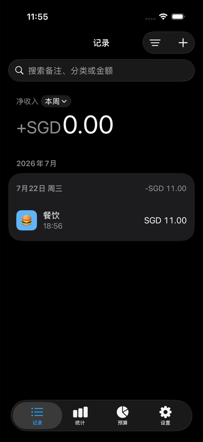
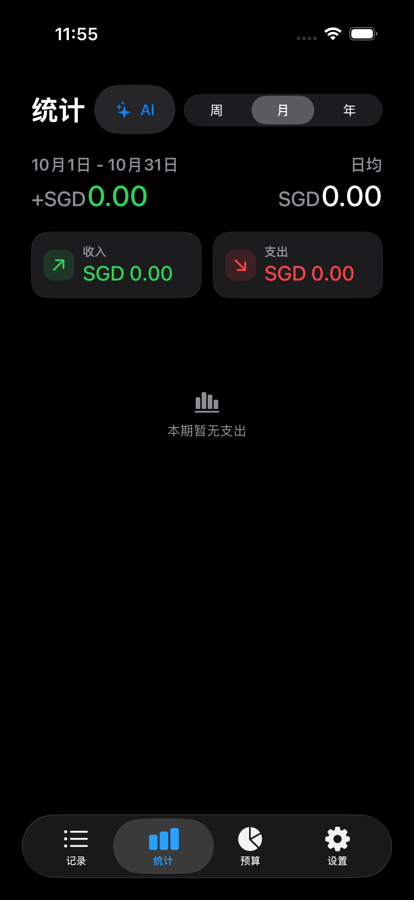
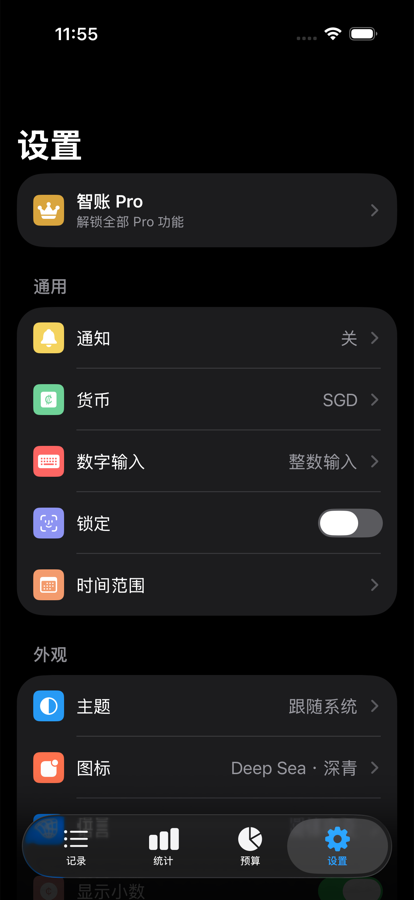

# SmartBud

  

<!-- TODO: Replace `id1635280255` with SmartBud's App Store ID once SmartBud is published as a new listing. Current ID points to the legacy listing. -->
SmartBud is a 100% free, open-source personal finance tracker built with iOS design guidelines in mind. [Download SmartBud on the App Store.](https://apps.apple.com/sg/app/id1635280255)

## App Preview

   
   
  
  

  
  
  

## Why You'll Love SmartBud

- Beautifully iOS-centric design, with simplicity at its core.
- Insightful expenditure breakdowns over various time periods.
- Create budgets based on expense categories and stick to them.
- Create recurring expenses with custom time frames.
- Track accounts and transfers, including cross-currency moves with a per-transfer rate and fee.
- Mark an expense as reimbursable: it stays in the ledger but out of your spending totals until it is paid back.
- Restore everything from the JSON backup, or export a CSV for a spreadsheet.
- Automate entries with `smartbud://` URLs and x-callback-url from Shortcuts or any launcher.
- Sync your expenses, categories and budgets with other devices via iCloud.
- Custom reminders to input your expenses.
- Biometric authentication to protect your data.
- Home screen quick actions make capturing new expenses a breeze.
- A gorgeous night theme for dark mode fanatics.
- Informative home and lock screen widgets keep you updated at a glance.
- **SmartBud Pro** unlocks Batch Recognition, Advanced Insights, Exclusive Themes, Smart Reminders and Priority Support. Pick a monthly, half-yearly, or yearly auto-renewing subscription, or unlock everything forever with a one-time lifetime purchase. iCloud sync is available for free for all users.

## How to help

- Please feel free to raise [issues](https://github.com/iorest/smartbud/issues) for any inquiries, suggestions for improvements, or bugs you encounter.
- You're welcome to fork the repository and propose changes through a pull request, although the decision to merge it rests with the project maintainers.
- If you would like to discuss with the contributors, feel free to drop [Iorest](https://x.com/iorest) or [Jeffrey](https://x.com/jefcodes) a DM!

## How to build

### Required

- Xcode

### Build Steps

- Clone this project either via Xcode or terminal:
  `git clone https://github.com/iorest/smartbud.git`
- For branch selection use:
  `--single-branch --branch [branchname]` after `clone`
- After completion, open `SmartBud.xcodeproj` using Xcode.
- Please let all dependecies update automatically but we would recommend to run
  `File > Packages > Resolve Package Versions` to ensure, everything is updated.

## Documentation

- [Design](docs/design.md) — the full model: entities, money layers, feature contracts, caching, sync, and the gap list.
- [Ledger rules](docs/ledger-rules.md) — which row counts as spend, income, claim or adjustment, and where it shows up.
- [Data export and restore](docs/data-portability.md) — JSON backup format, import rules, CSV columns.
- [URL scheme](docs/url-scheme.md) — `smartbud://` routes and x-callback-url.
- [CloudKit checklist](docs/cloudkit-schema.md) — what to deploy before shipping a schema change.

## Licence

This project is licensed under the GNU General Public License v3.0 - see the [LICENSE](LICENSE) file for details.
